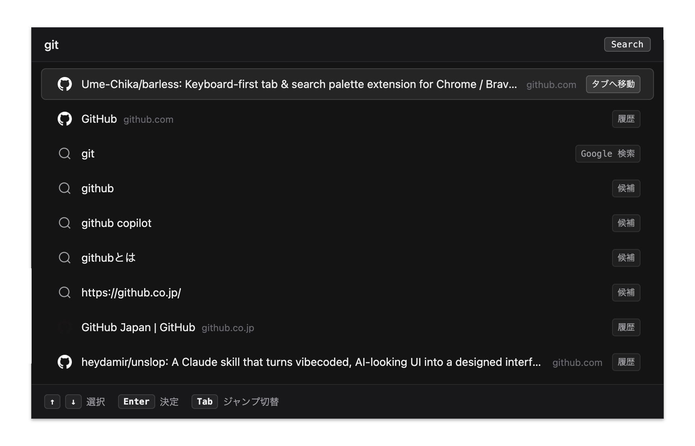
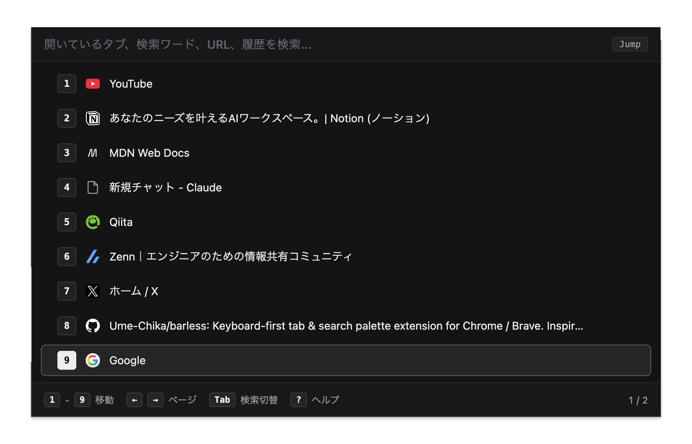

# Barless

Arc Browser のコマンドバーに着想を得た、Chrome / Brave 向けタブ切り替え・検索パレット拡張機能です。

  

---

## 概要

Chrome や Brave でタブが増えた際、開いているタブを探す手間や重複タブの乱立、そして分割ビュー操作の煩雑さを解消するための拡張機能です。

Arc Browser に着想を得た統合パレットを画面中央に呼び出し、タブ移動とWeb検索を同じ操作で行えます。ショートカットキーによる素早い画面分割にも対応します。

---

## 主な機能

### 1. タブ検索とWeb検索の統合

探したいページ名を入力すると、開いているタブを最優先で候補に表示します。該当するタブがない場合はそのままWeb検索へ移行するため、同じページを重複して開くのを防ぎます。未入力時はよくアクセスするサイトや最近の閲覧履歴を表示します。

### 2. 直感的な画面分割

マウスドラッグを必要とせず、`Shift + Enter` だけで2つのタブを左右に分割できます。タブグループに所属しているタブもグループを崩さずに一時分割し、分割解除時に元のグループへ自動返却されます。

### 3. 9スロット一覧と数字キージャンプ

パレットを開くと、開いているタブが左から順に9件ずつ一覧表示されます。数字キー `1`〜`9` またはクリックで対象のタブへ直接移動できます。

  

---

## 使い方

### 基本操作

| 操作                         | キー                                                       |
| :--------------------------- | :--------------------------------------------------------- |
| パレットを開く               | Mac:`Option + Space` / Windows: `Ctrl + Shift + Space` |
| スロット番号のタブへ直接移動 | `1` 〜 `9`                                             |
| 前後の項目を選択して移動     | `↑` / `↓` + `Enter`                                |
| ページを切り替え             | `←` / `→` または 2本指スワイプ                       |
| 選択中のタブを閉じる         | `Delete` / `Backspace`                                 |
| 選択中タブの URL をコピー    | `Cmd + C` / `Ctrl + C`                                 |
| タブ一覧と検索の切り替え     | `Tab`                                                    |
| 設定画面を開く               | `?`                                                      |
| パレットを閉じる             | `Esc`                                                    |

### 画面分割操作

`Shift + Enter` または `Shift + クリック` で操作します。

| やりたいこと          | 操作                                                            |
| :-------------------- | :-------------------------------------------------------------- |
| 2つのタブを左右に分割 | 1つ目のタブで `Shift + Enter` → 2つ目のタブで `Enter`      |
| タブと検索結果を分割  | 1つ目のタブで `Shift + Enter` → 検索候補を選択して `Enter` |
| 左右のタブを入れ替え  | 分割中のタブで `Shift + Enter` → 相方のタブで `Enter`      |
| 分割を解除            | 分割中のタブで 2回連続 `Shift + Enter`                        |

### 設定項目

パレット表示中に `?` キーを押すか、拡張機能アイコンを右クリックして「オプション」を選択すると設定画面が開きます。

| 設定項目               | 内容                                                     |
| :--------------------- | :------------------------------------------------------- |
| 検索エンジンの選択     | Google / Brave Search / DuckDuckGo から選択              |
| 検索サジェスト         | Google 検索サジェストの有効 / 無効                       |
| フッター案内           | 下部の操作キーガイドの表示 / 非表示                      |
| スロット番号キーの表示 | キーキャップ枠の表示 / 非表示                            |
| 新規タブスロットの表示 | タブ末尾へのスロット追加と、別タブ移動時の空タブ自動整理 |
| スマート分割           | 分割解除時に元のタブグループへ自動返却                   |
| クイック検索 URL       | 頻繁にアクセスする内部URL等の優先登録                    |
| ショートカット変更     | ブラウザのショートカット設定画面への導線                 |

---

## 設計方針とプライバシー

- **ゼロ外部依存**: 外部ライブラリやビルドツールを使用せず、HTML、CSS、Vanilla JS で構成されています。
- **モジュール分割**: 保守性を保つため、すべての JavaScript ファイルを200行以下に抑えています。
- **ローカル完結処理**: 閲覧履歴、開いているタブのURLやタイトル、設定データはブラウザ内部のみで処理され、外部サーバーへ送信・収集されることは一切ありません。
- **送信される情報**: 検索サジェスト有効時、入力した検索キーワード文字列のみが候補取得のため Google Suggest API へ直接送信されます。設定画面で検索サジェストを無効化すると、外部通信はゼロになります。

---

## インストール手順

1. Chrome は `chrome://extensions`、Brave は `brave://extensions` を開く
2. 右上の **デベロッパー モード** を有効にする
3. 左上の **パッケージ化されていない拡張機能を読み込む** から、本フォルダを選択する

初期ショートカットは Mac: `Option + Space`、Windows: `Ctrl + Shift + Space` です。変更する場合は `chrome://extensions/shortcuts` から設定できます。

---

## ライセンス

[MIT License](LICENSE) © 2026 Chikara Umeda
